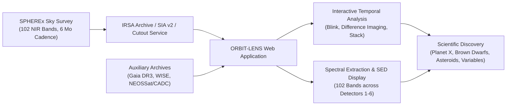
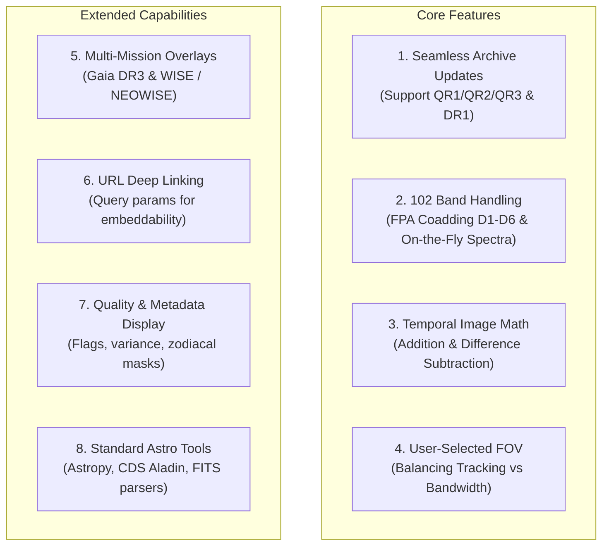
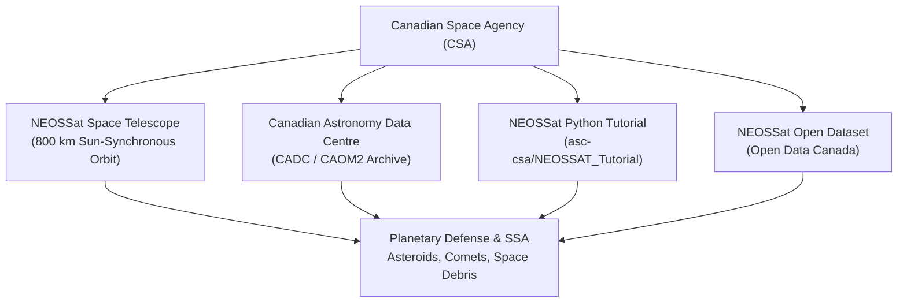
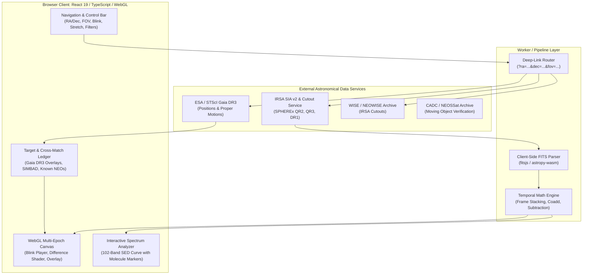

# Planet X and SPHEREx — NASA Space Apps Challenge 2026

**Challenge Track:** Planet X and SPHEREx  
**Host:** NASA Space Apps Challenge 2026 (Global Event: 14–15 November 2026)  
**Categories & Tags:** Advanced · Astrophysics · Planets & Moons · Software  
**Team Reference:** Team Schwarzschildren — Project ORBIT-LENS  
**Status:** Canonical Challenge Specification & Technical Resource Synthesis  
**Canonical URLs:**
- [Challenge Details](https://www.spaceappschallenge.org/2026/challenges/planet-x-and-spherex/?tab=details)
- [Challenge Resources](https://www.spaceappschallenge.org/2026/challenges/planet-x-and-spherex/?tab=resources)
- [Challenge Live Portal](https://www.spaceappschallenge.org/2026/challenges/planet-x-and-spherex/)

---

## Executive Summary & Challenge Charter

The **"Planet X and SPHEREx"** challenge tasks participants with developing a modern, public-facing, interactive web-based exploration platform capable of displaying and navigating time-series infrared imaging from NASA's SPHEREx mission. By enabling users to input sky coordinates (Right Ascension $\alpha$ and Declination $\delta$), view multi-epoch observations sequentially like a video or blink comparator, and manipulate spectral and temporal dimensions, the tool empowers both professional researchers and citizen scientists to detect moving solar system bodies, undiscovered sub-stellar objects (brown dwarfs), trans-Neptunian objects (TNOs), variable stars, and the hypothetical distant "Planet X".



---

## 1. Challenge Background & Scientific Rationale

### 1.1 The SPHEREx Space Mission
In May 2025, NASA launched the **SPHEREx** (*Spectro-Photometer for the History of the Universe, Epoch of Reionization and Ices Explorer*) space observatory into a low-Earth, Sun-synchronous polar orbit. SPHEREx is a pioneering all-sky spectral survey mission mapping the entire celestial sphere every six months across **102 distinct near-infrared (NIR) spectral bands** spanning wavelengths from $\lambda \approx 0.75\,\mu\text{m}$ to $5.0\,\mu\text{m}$.

* **All-Sky Mapping Cadence:** Full all-sky coverage every 6 months.
* **Volume:** Returning calibrated multi-epoch imaging for more than **1,000,000,000 (one billion)** astronomical objects, including stars, quasars, galaxies, supernovae, asteroids, comets, and brown dwarfs.
* **Molecular Sensitivity:** Due to its continuous 102-band spectral resolution ($R = \lambda/\Delta\lambda \sim 40\text{--}130$), SPHEREx is uniquely sensitive to key biogenic and astrophysical molecules, specifically water ice ($\text{H}_2\text{O}$), carbon monoxide ($\text{CO}$), carbon dioxide ($\text{CO}_2$), and hydrogen compounds in protoplanetary disks, interstellar clouds, and planetary atmospheres.
* **Data Scale:** The petabyte-scale stream of spatial and spectral cubes exceeds what automated algorithms or solo researchers can exhaustively inspect. Citizen science inspection and visual temporal tools are imperative.

### 1.2 The Physics of Temporal Astronomical Discovery
Celestial objects change position or brightness between successive observations due to several fundamental astrophysical phenomena:

1. **Proper Motion ($\mu$):** The intrinsic angular motion of stars and brown dwarfs relative to the Solar System as they orbit the Galactic center:
   $$\mu = \sqrt{\mu_\alpha^2 \cos^2\delta + \mu_\delta^2}$$
   Nearby high-proper-motion objects (e.g., Barnard's Star at $\sim 10.3''/\text{yr}$, or sub-stellar objects like WISE 0855) traverse discernible angular distances across multi-month baseline intervals.
2. **Trigonometric Parallax ($\varpi$):** As Earth orbits the Sun, nearby stars and brown dwarfs undergo apparent elliptical angular displacement against background distant stars:
   $$\varpi = \frac{1\,\text{AU}}{d}$$
   Comparing images spaced 6 months apart (the SPHEREx cadence) captures the maximum parallax baseline ($\approx 2\,\text{AU}$).
3. **Solar System Orbital Motion:** Comets, Near-Earth Asteroids (NEAs), Kuiper Belt Objects (KBOs), and hypothetical trans-Neptunian planets ("Planet X" / Planet Nine) orbit the Sun directly, moving rapidly against fixed stellar backdrops across days, weeks, and months.
4. **Photometric Variability:** Eruptive variable stars (e.g., RW Aurigae with episodic dust accretion/disk obscurations), pulsating giants (e.g., R Draconis), supernovae, and active galactic nuclei exhibit pronounced flux variations between epochs.

### 1.3 Historical Precedents & Citizen Science
- **Pluto (1930):** Clyde Tombaugh discovered Pluto at Lowell Observatory by mechanically alternating (blinking) two photographic plates taken on different nights using a Zeiss blink comparator.
- **Backyard Worlds: Planet 9:** Powered by Zooniverse and NASA WISE/NEOWISE time-series data, hundreds of thousands of citizen scientists have analyzed animated coadds and difference images, discovering over 4,000 cold brown dwarfs, extreme subdwarfs, and interstellar interlopers that automated computer pipelines missed due to blending, low signal-to-noise ratio, or complex background confusion.

---

## 2. Official Challenge Objectives & Core Requirements

### 2.1 Primary Objective
Create an intuitive, public-facing, responsive web tool that ingests and displays images of the sky from the SPHEREx mission, enabling users to:
1. Input celestial coordinates: **Right Ascension ($\alpha$ / RA)** and **Declination ($\delta$ / Dec)** in standard astronomical formats (sexagesimal or decimal degrees).
2. Retrieve multi-epoch images of the specified region of interest.
3. Display a sequential time-series visualization ("like a little video" or blink comparator) to rapidly spot moving celestial bodies and flux variables.

### 2.2 Prescribed Test Targets & Validation Benchmarks
The challenge explicitly specifies five benchmark astronomical targets that any submission tool MUST support and validate:

| Target Name | Coordinates ($\alpha, \delta$ J2000) | Astrophysical Class | Observable Characteristics in SPHEREx |
| :--- | :--- | :--- | :--- |
| **Barnard's Star** | `17h 57m 48.5s`, `+04° 41′ 36″` ($269.4521°, +4.6934°$) | High-velocity red dwarf (M4.0V) | Fastest known stellar proper motion ($\mu \approx 10.39''/\text{yr}$); noticeable displacement between 6-month SPHEREx epochs. |
| **Epsilon Indi B** | `22h 04m 10.5s`, `-56° 46′ 58″` ($331.0438°, -56.7828°$) | Sub-stellar binary (T1 + T6 brown dwarfs) | Cold, faint companion system orbiting $\epsilon$ Indi A; high proper motion ($\mu \approx 4.7''/\text{yr}$); strong methane absorption bands. |
| **WISE 0855** | `08h 55m 10.831s`, `-07° 14′ 42.53″` ($133.7951°, -7.2451°$) | Sub-stellar Y-dwarf | Coldest known brown dwarf ($T_{\text{eff}} \approx 250\text{--}260\,\text{K}$); discovered via multi-epoch WISE; $\mu \approx 8.1''/\text{yr}$; extremely faint in optical, luminous in mid-NIR. |
| **RW Aurigae** | `05h 07m 49.5s`, `+30° 24′ 05″` ($76.9564°, +30.4014°$) | Classical T Tauri binary variable star | Complex protostellar disk with dramatic, non-periodic occultation drops ($\Delta V \approx 2\text{--}3\,\text{mag}$); molecular emission in infrared. |
| **R Draconis** | `16h 32m 40.2s`, `+66° 45′ 18″` ($248.1676°, +66.7551°$) | Mira-type pulsating AGB red giant | Regular, large-amplitude pulsation cycle ($\text{Period} \approx 245.6\,\text{days}$); large visual/IR flux variations ($\Delta m \approx 6\text{--}8\,\text{mag}$). |

---

## 3. Potential Considerations & Advanced Technical Features

The official challenge guidelines identify eight key technical opportunities:



### 3.1 Seamless Data Architecture & Update Support
- SPHEREx data releases occur rapidly as orbital surveys accumulate:
  - **QR1 (Quick Release 1):** Initial survey checkout; retired February 2026.
  - **QR2 (Quick Release 2):** Intermediate calibration release.
  - **QR3 (Quick Release 3):** Commenced distribution in September 2026.
  - **DR1 (Data Release 1):** Comprehensive calibrated survey release.
- The software must abstract data ingestion so newer releases are seamlessly accessible without rewriting the core query engines.

### 3.2 102 Spectral Bands & 6 Detector Arrays
- SPHEREx's focal plane is split via a dichroic beam splitter into two Focal Plane Assemblies (FPAs), housing **6 individual $2048 \times 2048$ detector arrays**:
  - **Detectors 1, 2, 3 (D1, D2, D3):** Short-wavelength channels ($\lambda \sim 0.75\text{--}2.4\,\mu\text{m}$).
  - **Detectors 4, 5, 6 (D4, D5, D6):** Long-wavelength channels ($\lambda \sim 2.4\text{--}5.0\,\mu\text{m}$).
- Behind Linear Variable Filters (LVF), each pixel corresponds to a slightly different central wavelength across the dispersion axis.
- **Detector Array Coadding:** To maximize Signal-to-Noise Ratio (SNR), the challenge suggests summing or median-stacking all spectral bands captured across each of the 6 detector arrays to produce high-contrast morphological images.
- **On-the-Fly Spectral Energy Distribution (SED):** Generating instantaneous flux spectra ($F_\lambda \text{ vs. } \lambda$) when clicking or hovering over any source in the field.

### 3.3 Temporal Image Math: Stacking & Difference Imaging
- **Image Subtraction (Difference Imaging):** Subtracting an earlier epoch from a later epoch ($\text{Epoch}_B - \text{Epoch}_A$):
  - Constant background stars and static galaxies cancel out to zero flux.
  - Moving objects appear as a characteristic **dipole** (a dark negative flux depression at position $A$ alongside a bright positive flux peak at position $B$).
  - Variable stars appear as positive or negative residual disks depending on brightening or dimming.
- **Shift-and-Add (Coaddition along Motion Vectors):** Stacking frames adjusted for trial proper motion vectors ($\mu_\alpha \cos\delta, \mu_\delta$) to build signal on faint fast-moving planetary or sub-stellar candidates below single-frame detection thresholds.

### 3.4 Variable Field of View (FOV)
- Users must be able to switch FOV:
  - **Small FOV (e.g., $1'\text{--}5'$):** Detailed high-resolution astrometry and inspection of stellar cores.
  - **Large FOV (e.g., $15'\text{--}60'$):** Broad context searching and tracking of fast-moving Solar System bodies (NEAs, comets, or high-velocity brown dwarfs), balancing network payload sizes.

### 3.5 Astronomical Cross-Mission Overlays
- **Gaia DR3 Integration:** Overlaying high-precision astrometric positions, proper motion vectors (arrows showing magnitude and direction of motion), and parallaxes from ESA's Gaia Data Release 3.
- **WISE / NEOWISE Overlays:** Comparing SPHEREx NIR frames with mid-infrared W1 ($3.4\,\mu\text{m}$) and W2 ($4.6\,\mu\text{m}$) observations taken over the previous decade.

### 3.6 Deep-Linking & Embeddability
- Supporting clean URL parameters (`?ra=...&dec=...&fov=...&epoch=...&band=...`) allowing citizen science portals, Reddit communities, scientific forums, and research papers to directly link to live candidate discoveries.

### 3.7 Metadata & Quality Assessment Display
- Surfacing crucial FITS Header and Multi-Extension metadata:
  - Observation timestamps (`DATE-OBS`, `MJD`).
  - Contamination and cosmic-ray masking flags.
  - Variance / error planes.
  - Zodiacal light background subtraction levels.
  - Point Spread Function (ePSF) models.

### 3.8 Integration with Standard Astronomical Toolchains
- Utilizing industry-standard libraries and engines:
  - **Astropy:** Coordinate transformations (`SkyCoord`), WCS world coordinate systems, unit handling, and table queries.
  - **CDS Aladin / Aladin Lite:** WebGL/Canvas-based hierarchical sky maps (HiPS) and interactive astronomical viewers.
  - **Astroquery:** Automated TAP/SIA client protocols.

---

## 4. NASA Data & Resources: Detailed Technical Analysis

### 4.1 NASA/IPAC Infrared Science Archive (IRSA) — SPHEREx Portal
- **Service Endpoint:** `https://irsa.ipac.caltech.edu/Missions/spherex.html`
- **Archive Documentation:** `https://caltech-ipac.github.io/spherex-archive-documentation/`
- **Primary Data Format:** Level 2 Spectral Image Multi-Extension FITS (MEF).
- **FITS Header & HDU Structure:**
  - `HDU 0`: Primary Header (pointing geometry, observation metadata, exposure timing, satellite ephemeris).
  - `HDU 1 (IMAGE)`: Calibrated 2D science image array in physical surface brightness / flux units ($\text{MJy/sr}$).
  - `HDU 2 (VARIANCE)`: Per-pixel measurement variance / uncertainty map ($\sigma^2$).
  - `HDU 3 (FLAGS)`: Bitmask array indicating bad pixels, cosmic rays, saturation, stray light, and optical contamination.
  - `HDU 4 (ZODIACAL)`: $2040 \times 2040$ modeled diffuse zodiacal light background.
  - `HDU 5 (EPSF)`: Spatially varying Effective Point Spread Function models on a $21 \times 21$ grid (Detectors 1, 2, 4, 5, 6) or $11 \times 41$ grid (Detector 3).

### 4.2 Data Access Protocols & Cutout Services
1. **IVOA Simple Image Access (SIA v2):**
   ```http
   GET https://irsa.ipac.caltech.edu/SIA?COLLECTION=spherex_qr3&POS=circle+133.7951+-7.2451+0.05&RESPONSEFORMAT=CSV
   ```
2. **IPAC Image Boundary Extraction (IBE) Cutout Service:**
   ```http
   GET https://irsa.ipac.caltech.edu/ibe/data/spherex/qr3/level2/{subpath}.fits?center=RA,DEC&size=DEGREES
   ```
   Enables on-the-fly extraction of sub-regions centered on any celestial coordinate without transferring the full $2048 \times 2048$ image files.
3. **Table Access Protocol (TAP):**
   ```sql
   SELECT a.uri, a.t_min, a.t_max, a.em_min, a.em_max
   FROM spherex_qr3.spectral_images AS a
   WHERE 1=CONTAINS(POINT('ICRS', a.s_ra, a.s_dec), CIRCLE('ICRS', 133.7951, -7.2451, 0.1))
   ORDER BY a.t_min ASC
   ```

### 4.3 SPHEREx Tutorial Notebooks (Caltech-IPAC)
- **Repository / Tutorials:** `https://caltech-ipac.github.io/irsa-tutorials/spherex/`
- **Core Modules Covered:**
  - `spherex-intro`: Overview of spectral image headers, coordinates, and WCS projection.
  - `spherex-cutouts`: Batch generation of Multi-Extension FITS cutouts using Python, Astropy, and Astroquery with multi-threaded concurrent download handling.
  - `spherex-psf`: PSF extraction and sub-pixel fitting.
  - `spherex-source-discovery-tool-demo`: Interactive source extraction and catalog cross-matching.
  - `spherex-mosaic` & `spherex-hipscube`: Reprojection into Hierarchical Progressive Surveys (HiPS) and 3D data cubes.

### 4.4 WiseView (byw.tools/wiseview) — The Gold Standard Model
- **Canonical Model:** `http://byw.tools/wiseview`
- Developed by Dan Caselden and the Backyard Worlds research team to navigate NASA WISE/NEOWISE infrared time-series imaging.
- **Architectural & Functional Breakdown:**
  - **Dynamic Stretch & Transfer Functions:** Asinh, Linear, Square Root, Logarithmic, Min/Max percentile clipping, and dynamic range inversion.
  - **Blink Comparator Controls:** Adjustable blink interval ($50\text{--}2000\,\text{ms}$), frame-by-frame scrubbing, reverse playback, and loop boundaries.
  - **Epoch Sliders & Windows:** User-selectable temporal bins and exclusion windows.
  - **Difference Imaging Engine:** Real-time adjacent-epoch image subtraction ($\Delta I = I_{t_2} - I_{t_1}$).
  - **Shift-and-Add Search Vector:** User-specified $\text{pmra}$ and $\text{pmdec}$ parameters in $\text{mas/yr}$; dynamically shifts sequential frames before coaddition to discover faint high-proper-motion targets.
  - **Gaia DR3 Cross-Match Layer:** Vector overlay displaying Gaia proper motion arrows and parallactic ellipses.
  - **Export Suite:** One-click generation of animated GIF loops, PNG snapshots, and raw FITS downloads.

### 4.5 Gaia Mission Data (STScI / ESA)
- **Data Portal:** `https://archive.stsci.edu/missions-and-data/gaia`
- **Recommended Release:** **Gaia Data Release 3 (Gaia DR3)**
- **Astrometric Parameters Available:**
  - Positions ($\alpha, \delta$) with sub-milliarcsecond precision.
  - Parallaxes ($\varpi$) yielding accurate distance calculations.
  - Proper motions ($\mu_\alpha^* \equiv \mu_\alpha \cos\delta, \mu_\delta$) enabling instant confirmation of whether a moving source in SPHEREx is a known Galactic star or an uncatalogued Solar System/interstellar candidate.
  - Broad-band optical photometry: $G$, $G_{\text{BP}}$, $G_{\text{RP}}$.

---

## 5. Space Agency Partner Resources: Canadian Space Agency (CSA)

The NASA Space Apps Challenge features international partner space agencies. For this challenge, the **Canadian Space Agency (CSA)** provides dedicated resources centered on space-based asteroid and moving-object tracking.



### 5.1 NEOSSat: Near-Earth Object Surveillance Satellite
- **Overview:** Launched on February 25, 2013, NEOSSat is Canada's agile microsatellite and the world's first space telescope dedicated to detecting and tracking asteroids, comets, satellites, and orbital space debris.
- **Spacecraft & Orbital Characteristics:**
  - **Dimensions & Mass:** Suitcase-sized microsatellite (~$65\,\text{kg}$).
  - **Orbit:** Polar Sun-synchronous orbit at an altitude of approximately $800\,\text{km}$, completing an Earth orbit every $100\,\text{minutes}$.
  - **Optical Payload:** $15\,\text{cm}$ Maksutov telescope with two $1024 \times 1024$ CCD detectors (one for science, one for fine-guidance tracking).
- **Scientific Role:** Operating outside the atmospheric scattering and day/night cycle that hinders ground observatories, NEOSSat sweeps the twilight sky near the Sun to pinpoint Atira/Apohele and Aten asteroids that approach Earth from the sunward direction. It provides crucial orbital tracking for Planetary Defense and Space Situational Awareness (SSA).
- **Official Portal:** [CSA NEOSSat Mission Page](https://www.asc-csa.gc.ca/eng/satellites/neossat/)

### 5.2 Canadian Astronomy Data Centre (CADC)
- **Archive Endpoint:** `https://www.cadc-ccda.hia-iha.nrc-cnrc.gc.ca/en/`
- Operated by the National Research Council of Canada (NRC-CNRC) Herzberg Astronomy and Astrophysics Research Centre.
- Houses extensive observational data from international facilities (JWST, CFHT, Gemini, JCMT, HST, NEOSSat, BRITE).
- Implements the Common Archive Observation Model (CAOM2) and IVOA TAP/ObsCore protocols for programmatic multi-messenger querying.

### 5.3 NEOSSat Python Data Tutorial (`asc-csa/NEOSSAT_Tutorial`)
- **GitHub Repository:** [asc-csa/NEOSSAT_Tutorial](https://github.com/asc-csa/NEOSSAT_Tutorial)
- An open-source pedagogical tutorial series demonstrating how to:
  1. Authenticate and query CADC and CSA endpoints for NEOSSat observations.
  2. Filter science frames by object type, exposure duration, and pointing coordinates.
  3. Load and inspect raw and preprocessed astronomical FITS frames using Astropy.
  4. Perform dark subtraction, flat-fielding, and bad-pixel masking.
  5. Identify moving asteroid trails and satellite streaks across sequential exposures.

### 5.4 NEOSSat Open Dataset (Government of Canada)
- **Portal:** [Open Data Canada — NEOSSat Dataset](https://data.asc-csa.gc.ca/dataset/neossat)
- Provides complete, publicly accessible archives of processed NEOSSat FITS files, observation logs, ephemeris data, and astrometric measurements, serving as an ideal parallel verification dataset for moving-target detection algorithms.

---

## 6. Synthesis: Technical Specifications for Project ORBIT-LENS

To address every dimension of the "Planet X and SPHEREx" challenge, the team's software platform (**ORBIT-LENS**) incorporates the following engineering architecture:

### 6.1 Architectural Block Diagram



### 6.2 Compliance Matrix Against Challenge Criteria

| Challenge Criterion | Official Guidance | ORBIT-LENS Implementation Architecture |
| :--- | :--- | :--- |
| **Coordinate Entry** | Input $\alpha$ (RA) and $\delta$ (Dec) | Unified parser supporting decimal degrees, sexagesimal (`HH:MM:SS.s`, `±DD:MM:SS.s`), and name resolution (via SIMBAD/NED resolver). |
| **Blink & Time-Series** | Display series of images like a video | WebGL hardware-accelerated blink player with variable cadence ($50\text{--}2000\,\text{ms}$), frame stepping, ping-pong looping, and scrubber. |
| **Data Update Readiness** | Easy to update with latest SPHEREx releases | Dynamic release selector querying IRSA SIA v2 (`spherex_qr2`, `spherex_qr3`, `spherex_dr1`) without client code modifications. |
| **102 Infrared Bands** | Creative display of bands; detector coadds; spectra | Two distinct display modes: (1) **Detector Coadds** (summed D1–D6 arrays for maximum SNR); (2) **Spectral Inspector** (interactive SED plot showing flux vs. $\lambda$ from $0.75\text{--}5.0\,\mu\text{m}$ with $\text{H}_2\text{O}$, $\text{CO}_2$, $\text{CO}$, and $\text{CH}_4$ molecular markers). |
| **Temporal Image Math** | Add together or subtract images | On-the-fly difference imaging ($\text{Epoch}_j - \text{Epoch}_i$) highlighting moving dipoles; shift-and-add coaddition with user-tunable $\text{pmra}$ and $\text{pmdec}$ vectors. |
| **Field of View** | Let users choose FOV | Variable zoom presets ($1'$, $5'$, $15'$, $30'$, $60'$) dynamically adjusting cutout requests. |
| **Cross-Mission Data** | Overlay data from Gaia or WISE | Direct client-side Gaia DR3 TAP query rendering proper-motion vectors; side-by-side or alpha-blended WISE W1/W2 comparison. |
| **Deep-Linking** | Query tool via URL parameters | Full state serialization into query string (`?ra=...&dec=...&fov=...&stretch=...&blink=...`), enabling one-click discovery sharing. |
| **Metadata & Quality** | Display contamination flags & metadata | Overlay toggles for HDU 3 flags (bad pixels, saturation, cosmic rays), HDU 2 variance error bars, and HDU 4 zodiacal light levels. |
| **Benchmark Targets** | Validate on 5 prescribed targets | Pre-loaded target selector with one-click access to Barnard's Star, $\epsilon$ Indi B, WISE 0855, RW Aurigae, and R Draconis. |

---

## 7. Official Document Heritage & Provenance

This document synthesizes and consolidates the complete public record from the NASA Space Apps Challenge platform, official IPAC/Caltech mission portals, and international partner resources:

1. [NASA Space Apps Challenge: Planet X and SPHEREx (Details)](https://www.spaceappschallenge.org/2026/challenges/planet-x-and-spherex/?tab=details)
2. [NASA Space Apps Challenge: Planet X and SPHEREx (Resources)](https://www.spaceappschallenge.org/2026/challenges/planet-x-and-spherex/?tab=resources)
3. [NASA/IPAC Infrared Science Archive: SPHEREx Mission](https://irsa.ipac.caltech.edu/Missions/spherex.html)
4. [SPHEREx Archive Documentation (Caltech-IPAC)](https://caltech-ipac.github.io/spherex-archive-documentation/)
5. [SPHEREx IRSA Tutorial Notebooks](https://caltech-ipac.github.io/irsa-tutorials/spherex/)
6. [WiseView: Interactive Multi-Epoch WISE Viewer](http://byw.tools/wiseview)
7. [MAST / STScI Gaia Mission Data](https://archive.stsci.edu/missions-and-data/gaia)
8. [Canadian Space Agency (CSA): NEOSSat Mission](https://www.asc-csa.gc.ca/eng/satellites/neossat/)
9. [Canadian Astronomy Data Centre (CADC)](https://www.cadc-ccda.hia-iha.nrc-cnrc.gc.ca/en/)
10. [CSA NEOSSat Python Tutorial (GitHub)](https://github.com/asc-csa/NEOSSAT_Tutorial)
11. [Government of Canada Open Data Portal: NEOSSat Dataset](https://data.asc-csa.gc.ca/dataset/neossat)
12. [Backyard Worlds: Planet 9 (Zooniverse)](http://backyardworlds.org/)
