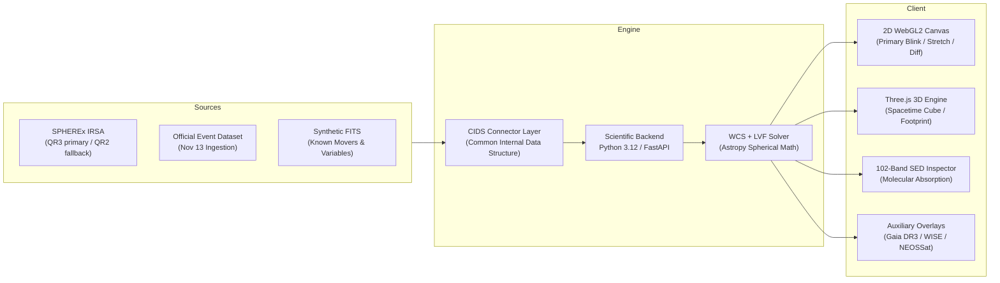
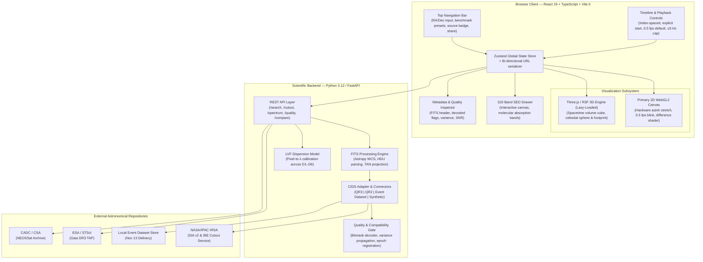
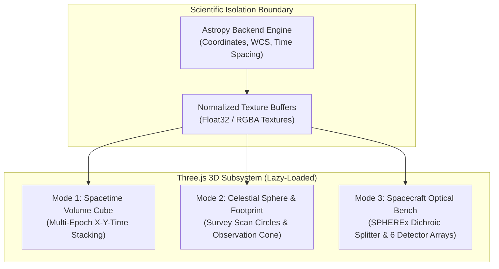
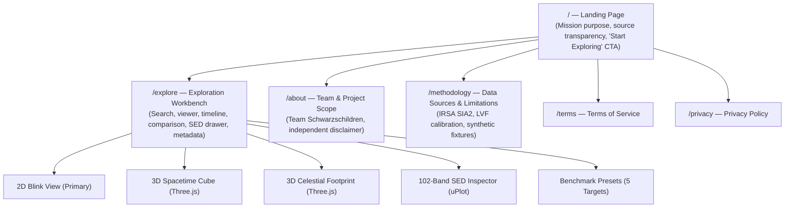

# ORBIT-LENS — Solution Architecture & Technical Implementation Plan

**Project Name:** ORBIT-LENS — *Explore the sky through time.*  
**Team:** Schwarzschildren  
**Challenge:** NASA Space Apps Challenge 2026 — *Planet X and SPHEREx*  
**Status:** Approved Engineering Plan (Updated for 2026 Participants Guide & 3D Strategy)  
**Docs:** [Challenge](Challenge.md) · [Guidance](Guidance.md) · [Prompt](Prompt.md) · [UI Guide](UI_guide.md) · [Aesthetics](Aesthetics_guideline.md) · [Policies](NASA_Policies.md) · [Terms](Terms_of_service.md)

---

## 1. Executive Summary & Architectural Tenets

ORBIT-LENS is a high-performance astronomical exploration workbench for multi-epoch near-infrared observations from NASA's SPHEREx mission. It empowers citizen scientists and researchers to discover moving objects (brown dwarfs, asteroids, trans-Neptunian bodies, hypothetical "Planet X") and variable stars by analyzing multi-epoch sky imagery.



### Core Tenets (Guided by `Guidance.md` & 2026 Participants Guide)

1. **Science over visuals.** Coordinate math, WCS projection, and quality validation live in the scientific backend. WebGL and Three.js render visuals only; they never interpret or transform celestial science data.
2. **Decoupled ingestion.** A Common Internal Data Structure (CIDS) insulates the entire UI and processing pipeline from archive schema changes. Switching between QR3, the November 13 event release, and synthetic test data requires a config toggle, not a code rewrite.
3. **Cutouts only.** Full $2048 \times 2048$ FITS images are never downloaded. All retrieval uses IVOA SIA v2, TAP, and IPAC Image Boundary Extraction (IBE) spatial cutouts ($0.05^\circ\text{--}0.5^\circ$).
4. **LVF dispersion awareness.** Wavelength varies continuously along the dispersion axis of each SPHEREx detector array ($D_1\text{--}D_6$). No image tile is treated as monochromatic.
5. **False-positive discipline.** Every candidate displacement or flux change is checked against HDU 3 bitmasks (cosmic rays, saturation, stray light) and HDU 2 variance before flagging a source.
6. **Transparent provenance.** Archive failure is surfaced immediately—silent substitution of synthetic data is strictly prohibited. The active source badge (SPHEREx, Simulated, External) remains permanently visible.

---

## 2. Full-Stack System Architecture



### CIDS — Common Internal Data Structure

The backend normalizes every observation source into one TypeScript-safe contract:

```typescript
interface ObservationRecord {
  id: string;
  sourceRelease: 'QR3' | 'QR2' | 'EVENT_NOV13' | 'SYNTHETIC';
  targetCoordinates: { ra: number; dec: number };       // ICRS decimal degrees
  epochTime: { utc: string; mjd: number; epochIndex: number };
  instrument: {
    detectorArray: 1 | 2 | 3 | 4 | 5 | 6;               // D1–D6
    fpa: 'Short-Wavelength' | 'Long-Wavelength';
    nominalBandpass: string;                             // e.g., 'SPHEREx-D2'
  };
  cutout: {
    pixelWidth: number;
    pixelHeight: number;
    fovDeg: number;                                      // Square angular width in degrees
    wcs: WCSParameters;                                  // CRVAL, CRPIX, CDELT, CTYPE, CROTA
  };
  dataPlanes: {
    flux: Float32Array;                                  // HDU 1 — Calibrated flux (MJy/sr)
    variance: Float32Array;                              // HDU 2 — Uncertainty map σ²
    flags: Uint32Array;                                  // HDU 3 — Quality bitmask
    zodiacal?: Float32Array;                             // HDU 4 — Modeled diffuse background
    epsf?: Float32Array;                                 // HDU 5 — Effective PSF model
  };
  wavelengthMap: Float32Array;                           // Per-pixel λ in μm from LVF solver
  qualityAssessment: 'compatible' | 'warning' | 'incompatible' | 'unknown';
}
```

---

## 3. Technology Stack & Framework Selection

| Layer | Technology | Version | Purpose & Architectural Justification |
| :--- | :--- | :--- | :--- |
| **Frontend Framework** | **React** | 19.x | Concurrent Mode, declarative component lifecycle, seamless Web Worker integration. |
| **Language & Typings** | **TypeScript** | 5.6+ | Strict type guarantees for FITS buffers, WCS matrix arrays, and CIDS records. |
| **Build & Tooling** | **Vite** | 6.x | Near-instant HMR, native ES module bundling, zero-overhead Web Worker creation. |
| **State Management** | **Zustand** | 5.x | Minimal boilerplate, non-blocking subscriptions for 60 fps canvas loops, bi-directional URL query sync. |
| **Primary 2D Viewport** | **WebGL 2.0 / GLSL** | Native | Hardware-accelerated dynamic `asinh` stretch, 0.5 fps blink comparator, sub-millisecond difference subtraction. |
| **3D Context Viewport** | **Three.js / React Three Fiber** | 0.170+ | Interactive spatiotemporal $(x, y, t)$ cube, celestial footprint sphere, and spacecraft exploded optical bench. |
| **Spectral Charting** | **uPlot** | Latest | Lightweight canvas charting of 102 spectral bands with microsecond hover crosshairs and molecular overlay spans. |
| **Scientific Backend** | **Python / FastAPI** | 3.12+ | High-performance async REST backend hosting Astropy, PyVO, and WCS coordinate transforms. |
| **Astro & FITS Engine** | **Astropy & NumPy** | 6.x | Canonical astronomical WCS projections (TAN), FITS HDU parsing, TAP/SIA client queries. |
| **Styling & Tokens** | **Tailwind CSS** | 4.x | Design token implementation strictly adhering to `Aesthetics_guideline.md` and WCAG 2.2 AA contrast. |
| **Iconography** | **Lucide React** | Latest | Geometric, restrained stroke icons for aperture, crosshair, database, and flask badges. |

---

## 4. The Three.js Strategy: Role, Architecture & Boundaries

The technical guidance (`Guidance.md`) and UI specifications (`UI_guide.md`) emphasize:
> *"Three.js should be responsible for rendering only. Astronomical coordinate transformations and measurements must be handled by the scientific processing layer... Don't let the 3D interface become the project's biggest task."*

To balance **scientific rigor (20/20 on Validity)** with **captivating presentation (20/20 on Creativity & Presentation for the 30-sec video and live demo)**, Three.js is deployed in three targeted, non-blocking modes:



### 4.1 Mode 1: 3D Spacetime Volume Cube (Temporal Stacking)
- **Concept:** Translates the 2D spatial cutouts $(x, y)$ into a 3D volumetric stack where the third axis ($Z$) represents observation time ($t$).
- **Visual Discovery Mechanism:**
  - Stationary background stars appear as vertical pillars extending straight through the time slices.
  - Moving objects (brown dwarfs, asteroids, Planet X candidates) form **diagonal, tilted trajectory tracks** connecting successive epochs.
  - Variable stars (RW Aurigae, R Draconis) appear as pillars with alternating luminous nodes and dark constrictions.
- **Implementation:** Custom Three.js instanced mesh plane stack with adjustable layer spacing and transparency alpha blending.

### 4.2 Mode 2: Celestial Sphere & Survey Footprint
- **Concept:** Renders a semi-transparent 3D celestial sphere in ICRS coordinates showing:
  - The SPHEREx satellite's low-Earth polar orbit precession.
  - The 6-month survey scan circles across the sky.
  - The user's requested FOV cone projected onto the celestial sphere, showing exactly which survey stripe covered the target.

### 4.3 Mode 3: SPHEREx Spacecraft & Optical Bench Exploded View
- **Educational Anchor for Video Submissions:**
  - An interactive 3D model of the SPHEREx telescope payload.
  - Visualizes incoming light hitting the **dichroic beam splitter**, which divides the beam into the two Focal Plane Assemblies (FPAs):
    - Short-wavelength array: Detectors 1, 2, 3 ($0.75\text{--}2.4\,\mu\text{m}$).
    - Long-wavelength array: Detectors 4, 5, 6 ($2.4\text{--}5.0\,\mu\text{m}$).
  - Shows the Linear Variable Filters (LVF) mounted in front of each array, visually explaining why wavelength varies continuously across the detector.

### 4.4 Technical Guardrails for Three.js
1. **Lazy Loading:** Three.js and `@react-three/fiber` bundles are isolated into dynamic `import()` chunks. The initial page load renders the lightweight 2D WebGL2 canvas in under 100 ms.
2. **Read-Only Presentation:** Three.js never calculates coordinates or distances. It consumes pre-computed normalized textures and WCS matrices supplied by the backend.
3. **Graceful Fallback:** If WebGL context is lost or low-end mobile hardware is detected, the UI gracefully defaults to the standard 2D viewer without error.

---

## 5. Application Sitemap



> **Routing Rule:** `/explore` must be directly accessible via deep links (`/explore?ra=133.7951&dec=-7.2451&fov=0.1`) without requiring prior navigation to `/`.

---

## 6. Detailed Workspace Specifications: `/explore`

### 6.1 Top Bar & Search Controls
- **Coordinate Inputs:**
  - Formats: Decimal degrees (`133.7951, -7.2451`) or Sexagesimal (`08h 55m 10.83s, -07° 14′ 42.5″`).
  - Pre-validation: Parsed decimal coordinates are displayed before submission.
  - Validation bounds: RA $\in [0, 360)$, Dec $\in [-90, +90]$. RA $= 360^\circ$ is rejected with an inline prompt to enter $0^\circ$. Sign preserved for `-00:30:00`.
- **FOV Selector:** Square angular width in degrees: `0.05°`, `0.1°`, `0.25°`, `0.5°`, plus custom entry within backend limits.
- **Source Selector:** Explicit dropdown — `SPHEREx Archive`, `Official Event Dataset`, `Simulated Demo`.
- **Release Selector:** Populated dynamically from backend capabilities (`QR3`, `QR2`, `EVENT_NOV13`).
- **Benchmark Presets Dropdown:** Direct one-click access to the 5 official challenge targets.
- **Active Source Badge:** Permanently visible badge indicating current source type:
  - 🔵 **Cyan Outline:** SPHEREx Archive Data
  - 🟡 **Amber Outline:** Simulated / Synthetic Demo
  - 🟣 **Lavender Outline:** External Survey (Gaia / WISE)
- **Share Discovery Button:** Serializes application state to URL query parameters.

### 6.2 Viewport Area (2D / 3D Toggle)
- **View Mode Switcher:** Tabs to toggle between:
  - `2D Blink Canvas` (WebGL2, primary)
  - `3D Spacetime Cube` (Three.js temporal stack)
  - `3D Sky Footprint` (Three.js celestial sphere)
- **2D Canvas Capabilities:**
  - Dynamic `asinh` astronomical stretch with tunable softening parameter $\beta$.
  - Linear, Logarithmic, and Min-Max (0.5%–99.5%) percentile clipping presets.
  - Invert pixel values toggle (black-on-white vs. white-on-black).
  - WCS-derived coordinate crosshair readout: $(\alpha, \delta)$, physical flux ($I$ in $\text{MJy/sr}$), uncertainty ($\sigma$), and wavelength ($\lambda$).
  - Physical scale bar ($'$) and North-East astronomical orientation arrows.
- **Keyboard Navigation:** Arrow keys for panning, `+`/`-` for zooming, `R` to reset view, `Space` for play/pause.

### 6.3 Timeline & Playback Dock
- **Observation Representation:** Displays retrieved observations only; irregular observation dates are honestly indicated (never interpolated or fabricated).
- **Index-Spaced Spacing:** Default display uses observation-index spacing, with elapsed intervals indicated textually.
- **Playback Controls:**
  - Start/Pause toggle, Previous/Next frame buttons, First/Last frame buttons.
  - **Safety defaults:** Starts paused, does not loop by default, stops at the last available frame.
  - **Cadence selector:** 0.5 transitions/sec (accessible default), 1.0, 2.0. Hard-capped at 3.0 Hz to prevent photosensitive epileptic triggers.
  - Automatically pauses when the browser tab becomes hidden.

### 6.4 102-Band SED Drawer (Collapsible)
- Click anywhere on the viewer to extract the full spectral energy distribution at that celestial coordinate.
- Plots flux density ($F_\nu$ in $\text{MJy/sr}$) vs. wavelength ($\lambda$ from $0.75\,\mu\text{m}\text{--}5.0\,\mu\text{m}$) across all 102 channels.
- Error bars derived from HDU 2 measurement variance ($\pm \sigma$).
- Overlay reference bands for key molecules:
  - Water ice ($\text{H}_2\text{O}$): $3.0\,\mu\text{m}$
  - Carbon dioxide ($\text{CO}_2$): $4.26\,\mu\text{m}$
  - Carbon monoxide ($\text{CO}$): $4.67\,\mu\text{m}$
  - Methane ($\text{CH}_4$): $1.66\,\mu\text{m}$ and $3.3\,\mu\text{m}$ (critical for Y/T brown dwarf confirmation)

### 6.5 Metadata & Quality Inspector (Right Drawer)
Structured into six verifiable sections per `UI_guide.md` §9:
1. **Observation:** Product ID, observation timestamp (UTC & MJD), exposure time ($T_{\text{exp}}$).
2. **Spectral Context:** Active detector array ($D_1\text{--}D_6$), central $\lambda$ at cursor, channel bandwidth ($\Delta\lambda$).
3. **Coordinates:** ICRS frame, TAN projection, pixel scale, cutout footprint dimensions.
4. **Quality Assessment:** Decoded HDU 3 bitmask flags (cosmic rays, saturation, bad pixels), pixel mask count, variance status, $\text{SNR} = I/\sigma$.
5. **Processing:** Release version, calibration pipeline, background subtraction status, display stretch parameters.
6. **Provenance:** Ingestion timestamp, canonical source URL, processing recipe hash.

---

## 7. Mathematical & Astronomical Foundation

### 7.1 Gnomonic (TAN) Projection — Sky to Tangent Plane
Conversion from spherical celestial coordinates $(\alpha, \delta)$ to tangent plane coordinates $(x, y)$:

$$x = - \frac{\cos\delta \sin(\Delta\alpha)}{\sin\delta \sin\delta_0 + \cos\delta \cos\delta_0 \cos(\Delta\alpha)}$$

$$y = \frac{\cos\delta_0 \sin\delta - \sin\delta_0 \cos\delta \cos(\Delta\alpha)}{\sin\delta \sin\delta_0 + \cos\delta \cos\delta_0 \cos(\Delta\alpha)}$$

Where $(\alpha_0, \delta_0)$ is the projection reference point (`CRVAL1`, `CRVAL2`). To ensure smooth navigation across the vernal equinox ($0^\circ/360^\circ$ boundary):

$$\Delta\alpha = ((\alpha - \alpha_0 + 180^\circ) \bmod 360^\circ) - 180^\circ$$

### 7.2 Linear Variable Filter (LVF) Dispersion Model
For detector array $k \in \{1, \dots, 6\}$, wavelength varies linearly along the dispersion axis $p$:

$$\lambda_k(p) = \lambda_{0,k} + \left(\frac{d\lambda}{dp}\right)_k \cdot (p - p_{0,k})$$

Where $\lambda_{0,k}$ is the reference wavelength, $p_{0,k}$ is the reference pixel coordinate, and $(d\lambda/dp)_k$ is the calibrated dispersion gradient.

### 7.3 Astronomical `asinh` Dynamic Range Stretch
Near-infrared surface brightness spans over five orders of magnitude. The WebGL fragment shader applies an inverse hyperbolic sine stretch:

$$I_{\text{display}} = \frac{\operatorname{asinh}\!\left(\dfrac{I - I_{\min}}{\beta}\right)}{\operatorname{asinh}\!\left(\dfrac{I_{\max} - I_{\min}}{\beta}\right)}$$

Where $\beta$ is the softening parameter: faint background noise remains linear, while bright stellar cores compress smoothly without saturating.

### 7.4 Shift-and-Add Coaddition for Faint Movers
To uncover faint outer solar system bodies or Planet X candidates moving at trial proper motion $(\mu_\alpha^*, \mu_\delta)$, frames at epochs $t_i$ relative to $t_0$ are shifted by:

$$\Delta x_i = \mu_\alpha^* \cdot (t_i - t_0), \quad \Delta y_i = \mu_\delta \cdot (t_i - t_0)$$

The coadded image is computed via variance-weighted stacking:

$$I_{\text{coadd}}(x, y) = \frac{\displaystyle\sum_i \frac{I_i(x - \Delta x_i, y - \Delta y_i)}{\sigma_i^2(x - \Delta x_i, y - \Delta y_i)}}{\displaystyle\sum_i \frac{1}{\sigma_i^2(x - \Delta x_i, y - \Delta y_i)}}$$

---

## 8. Hackathon Timeline, Video Deliverables & Judging Rubric

Aligned with the **2026 NASA Space Apps Challenge Participants Guide (Bangladesh Local Events)**:

### 8.1 Hackathon Mission Timeline

| Date & Time | Milestone | Requirement & Action |
| :--- | :--- | :--- |
| **Friday, 13 Nov 2026 (Morning)** | **Hackathon Kickoff** | Official dataset & Global Offers unlock. Verify dataset schema against CIDS connector. |
| **Friday, 13 Nov 2026 (6:30 PM)** | **Video 2 Due (240 sec)** | **Local Judging Cut:** 4-minute video demonstrating working prototype, team members, and NASA SPHEREx data named out loud. |
| **Saturday, 14 Nov 2026 (12:00 PM)** | **Video 3 Due (30 sec)** | **Global Judging Video:** Under 30 seconds, high-impact storytelling for global NASA judges. |
| **Saturday, 14 Nov 2026 (Evening)** | **Project Page Submission** | Submission portal closes. All GitHub repos public, open-source license committed, AI disclosures logged. |

### 8.2 Official Judging Rubric (100-Point Target Alignment)

| Criterion | Points | Evaluation Standard | ORBIT-LENS Architecture Compliance |
| :--- | :---: | :--- | :--- |
| **Impact** | 1–20 | Scale & significance of problem; transformative solution. | Unlocks SPHEREx's 1B+ object catalog for citizen science discovery of Planet X, brown dwarfs, and NEOs. |
| **Creativity** | 1–20 | Originality of idea and execution; bold new spin. | Three.js Spacetime Volume Cube ($(x, y, t)$ stack) + hardware WebGL2 blink comparator + interactive 102-band SED solver. |
| **Validity** | 1–20 | Scientific soundness, technical feasibility, working demo. | Grounded in Astropy WCS, LVF dispersion physics, Level 2 MEF headers, and verified on 5 official benchmark targets. |
| **Relevance** | 1–20 | Alignment to challenge; NASA data at core. | Purpose-built for SPHEREx IRSA SIA v2/IBE cutouts; deep integration of Gaia DR3 and NEOSSat/CADC partner data. |
| **Presentation** | 1–20 | Narrative clarity, structured storytelling, polish. | Clean UI adhering to `Aesthetics_guideline.md`; tailored 30s global video and 240s local demo. |
| **Teamwork** | 1–5 | Evidence of authentic multi-disciplinary collaboration. | Documented team roles across astronomy, backend, WebGL/Three.js frontend, and UI design. |
| **User Experience** | 1–5 | Accessibility without specialized training (5 = anyone can use). | Pre-loaded target presets, accessible 0.5 fps default, WCAG 2.2 AA compliant, inline coordinate helper text. |
| **NASA Data Usage** | 1–5 | Transparent, central usage of NASA open data. | Explicit source badges, copyable FITS URLs, and unmasked HDU 0–5 metadata. |

---

## 9. Phased Implementation Order

Development strictly follows the 8-phase milestone order recommended in `Guidance.md` §4:

| Phase | Milestone Deliverable | Verification Gate |
| :---: | :--- | :--- |
| **1** | Real SPHEREx cutout retrieval via IRSA SIA2/IBE; Level 2 MEF parser. | Real SPHEREx FITS HDU 0–5 loads and unpacks correctly. |
| **2** | CIDS layer + swappable connectors (QR3, QR2 fallback, synthetic FITS). | Switching data source in config requires zero UI changes. |
| **3** | Primary 2D WebGL2 blink canvas (0.5 fps default, paused, timeline). | Barnard's Star motion clearly visible between observation epochs. |
| **4** | Quality gate: HDU 3 bitmask decode + HDU 2 variance on click. | Cosmic ray flag (0x0004) correctly flagged as artifact, not a mover. |
| **5** | 102-band SED drawer + LVF dispersion model. | WISE 0855 methane ($\text{CH}_4$) absorption band confirmed at 1.66 & 3.3 μm. |
| **6** | Three.js 3D Spacetime Cube & Footprint modes (lazy-loaded). | Spacetime cube displays diagonal mover trajectory smoothly at 60 fps. |
| **7** | Gaia DR3 proper motion overlay + deep link URL state synchronization. | Restoring shared URL accurately reconstructs view state. |
| **8** | Difference imaging (phased), WCAG 2.2 AA audit, Video 2 & 3 asset export. | Working demo recorded for 6:30 PM local judging deadline. |

---

## 10. Compliance, Policy & Legal Guardrails

- **Mandatory Site Disclaimer:** Every view and presentation slide must display:  
  > *ORBIT-LENS is an independent project by Team Schwarzschildren. It uses publicly accessible astronomical resources and is not operated or endorsed by NASA, Caltech/IPAC, or the SPHEREx mission.*
- **Branding Guardrails:** Original text-led ORBIT-LENS wordmark only. NASA insignia and SPHEREx mission seals are strictly prohibited from product identity.
- **Under-18 Privacy Rule:** Per Participants Guide §10, no recognizable names, voices, or faces of anyone under 18 may appear in videos or submissions.
- **Open Source Licensing:** All original project code distributed under the Apache-2.0 open-source license.
- **Resource Register:** All external libraries, datasets, fonts, and AI assistance tools logged in the project provenance register per `NASA_Policies.md` §3.
